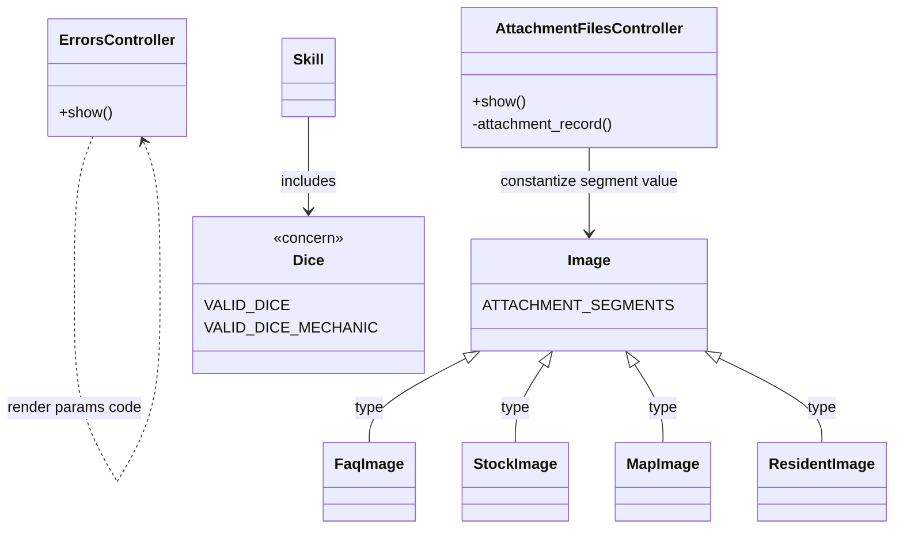
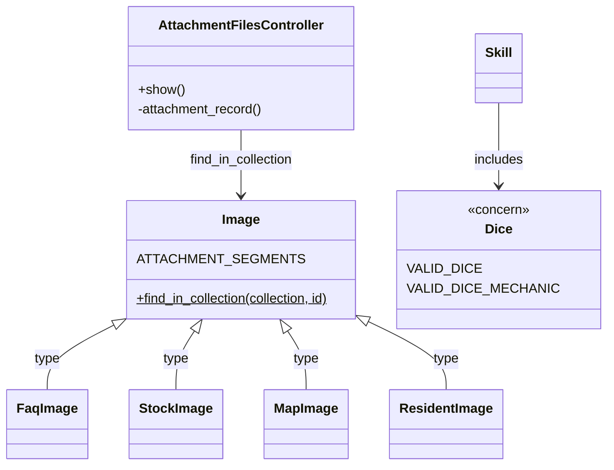
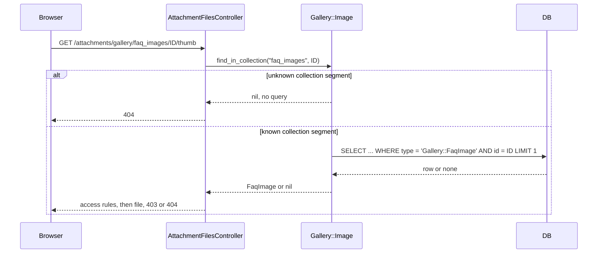

# Plan: Fix security audit findings

From `intent.md` (2026-11-11). Status: accepted.

## Design

### Domain terms

No `GLOSSARY.md` exists yet, so no avoid-list applies. The plan uses these terms. They are not written to the glossary until Etienne agrees them.

- **Dice mechanic**: the value of a dice-mechanic field. It is a dice expression (the `Dice::VALID_DICE` shape), `Standard`, `Fate` or `Roll Under`, and nothing else.
- **Collection segment**: the second segment of a gallery attachment path, for example `faq_images` in `/attachments/gallery/faq_images/<id>/thumb`. `Gallery::Image::ATTACHMENT_SEGMENTS` maps it to one image type.
- **Image type**: the STI `type` value of a `Gallery::Image` row, for example `"Gallery::FaqImage"`.

### Diagrams

Before: the touched objects as they are now.



After: the touched objects once the change lands. `ErrorsController` is gone; the views in `app/views/errors/` stay, rendered directly by the controllers that render them today.



Attachment lookup after the change:



ER: Not affected: no table, column or migration changes.

### Signatures

`ErrorsController` is deleted, with `test/controllers/errors_controller_test.rb`. No route reaches it and nothing calls it. No signature replaces it. The templates `app/views/errors/403.html.erb` and `404.html.erb` stay: about 14 controllers render them with `render template: "errors/404"` (or `403`), `layout: "layouts/application"` and a literal status.

`Gallery::Image` is the STI base of gallery pictures. It keeps `ATTACHMENT_SEGMENTS` with its string values, because `HasAttachedPicture#file_url` reads it in reverse. It gains one class method:

```ruby
# Finds the image with this id only when its image type belongs to the collection segment.
#: (String collection, String id) -> Gallery::Image?
def self.find_in_collection(collection, id)
  type = ATTACHMENT_SEGMENTS[collection]
  find_by(type:, id:) if type
end
```

STI instantiates the subclass from the `type` column, so `allowed_to_show_attachment?` and `publicly_cacheable?` still match on `Gallery::FaqImage` and the others. The `if type` guard keeps an unknown segment from querying `type IS NULL`.

`AttachmentFilesController` serves a gallery attachment the visitor may see. Its public surface does not change. In the private `attachment_record`, the `constantize` line becomes:

```ruby
in [ "gallery", collection_name, id, _ ]
  Gallery::Image.find_in_collection(collection_name, id)
```

`Dice` holds the dice rules of entitybuilder models. Only `VALID_DICE_MECHANIC` changes. One `\A ... \z` pair wraps a non-capturing group of every alternative. It stays a literal regex, because Brakeman's ValidationRegex check reads literals only.

```ruby
VALID_DICE_MECHANIC = /\A(?:[0-9]+d[0-9]+(?:\+*[0-9]+d[0-9]+)*|Standard|Fate|Roll Under)\z/
```

Each of the six validators that use it splits in two. The length check stays unconditional, as today. The format check gains a change guard, so a stored legacy value does not block an unrelated save:

```ruby
# skill.rb, ability_score.rb, base_value.rb, movement.rb, saving_throw.rb
validates :dice, length: { maximum: 255 }, allow_nil: true
validates :dice, format: { with: VALID_DICE_MECHANIC }, allow_nil: true, if: :will_save_change_to_dice?
# attack.rb
validates :attack_dice, length: { maximum: 255 }, allow_nil: true
validates :attack_dice, format: { with: VALID_DICE_MECHANIC }, allow_nil: true, if: :will_save_change_to_attack_dice?
```

The code gets an inline `#:` signature only on the public method this change adds (`Gallery::Image.find_in_collection`), and a one-line class summary on `Gallery::Image` when absent. Untouched methods stay as they are.

Not checked: City of Brass has no Steep or rbs_rails setup.

### Complexity

- `ErrorsController` deletion: no new path. Pages that render `errors/404` or `errors/403` keep their queries as today.
- `Gallery::Image.find_in_collection`: 0 queries for an unknown collection segment; 1 query (`WHERE type = ? AND id = ? LIMIT 1`) for a known one. Today the path also runs 1 query. The resident access check still loads the resident with 1 more query, as today.
- `VALID_DICE_MECHANIC`: one match per changed field. The length validator does not stop the format validator, so the match runs on the full submitted value, of any length. Same backtracking shape as `VALID_DICE` today; Ruby 3.4 regex memoization keeps the cost linear in the input length. 0 queries.

### Invariants

1. No request value reaches `render`, a status or `constantize`. Enforced by the deletion of `ErrorsController` and by `find_in_collection`; checked by `bundle exec brakeman` reporting 0 warnings.
2. A page that renders `errors/404` answers 404 and shows the 404 page. Enforced by the template staying in place; checked by a characterisation test that passes before and after the deletion.
3. A newly set or changed dice-mechanic field is nil or exactly one dice mechanic, with nothing around it. Enforced by the format validation on six entitybuilder models.
4. A stored dice-mechanic value that the field does not change never makes the record invalid. Enforced by the `will_save_change_to_<field>?` guard.
5. A gallery image is found only under the collection segment of its own image type. Enforced by the `type` condition in `Gallery::Image.find_in_collection`.
6. An unknown collection segment finds nothing and runs no query. Enforced by the `if type` guard.
7. `file_url` builds a path that `find_in_collection` resolves to the same image. Enforced by both reading `ATTACHMENT_SEGMENTS`.

### Alternatives

1. **Least change** (architect 1): inline `find_by(type:, id:)` in the controller's private `attachment_record`. Rejected: the controller keeps knowing the segment map and the STI `type` column (connascence of meaning across a boundary).
2. **Deepest model** (architect 2): move `ATTACHMENT_SEGMENTS` into `Gallery::HasAttachedPicture` as a private `COLLECTION_TYPES` with `find_in_collection` as a concern class method. Rejected: it touches two more files and renames a constant for no behaviour gain, since `Gallery::Image` is the only includer.
3. **Chosen**: the finder on `Gallery::Image`, next to the map it reads; the anchored regex from both; plus the change guard that both architects left open.

`ErrorsController` has no design alternatives here: `intent.md` `## Decisions` fixes its deletion. The earlier rewrite behind a new `/errors/*code` route is withdrawn. The architects' gallery and dice designs above stand unchanged from the first plan round.

## Design decisions

- **Prove the kept 404 page with one characterisation test.** The criterion "A page that renders `errors/404` still answers 404 and shows the 404 page" needs a test that checks the page content, not only the status. Existing tests assert `:not_found` only. The plan adds one test on `MessagesController`, which already renders `errors/404` for a stranger's message. It passes before and after the deletion; that is its purpose.
- **Guard the dice format validators with `will_save_change_to_<field>?`.** `intent.md` says "Only new and changed values face the stricter rule". Without the guard, a record holding a legacy value such as `1d20 Standard` fails its next save even when only its name changes. The guard covers the format check only; the length check stays unconditional, because `intent.md` grandfathers values against the stricter format, not against the existing length rule.
- **Keep `ATTACHMENT_SEGMENTS` public and in place.** `file_url` reads it; moving it has no behaviour gain.
- **No conflict with `intent.md` `## Decisions`.** `ErrorsController` is deleted and its views stay. The `constantize` call goes by refactor, not by an ignore entry. `trix` goes to 2.1.19 with a `dompurify` re-lock. `@rails/actiontext` stays.

## Integration points

- Rails routing (`config/routes.rb`): unchanged. No route names `errors#show` today, so the deletion leaves no dangling route.
- The `errors/404` and `errors/403` templates, rendered directly by controllers in `app/` and the engines: unchanged.
- Active Storage serving through `AttachmentFilesController`, with STI on `gallery_images.type`.
- Entitybuilder forms and the importer, which save the six dice-mechanic models. A scan of the stock JSON under `config/`, `engines/` and `db/` found no dice value the new regex rejects.
- npm: `trix` 2.1.19 still depends on `dompurify ^3.2.5`. The re-lock must resolve a `dompurify` above 3.4.16, outside the advisory range `<=3.4.16`; 3.4.17 is the newest at plan time. `.npmrc` holds `legacy-peer-deps=true` for the Action Text peer conflict and stays as it is.

## Files that change

- `test/controllers/message_controller_test.rb` — one characterisation test: a stranger's message answers 404 and shows the 404 page.
- `app/controllers/errors_controller.rb` — deleted.
- `test/controllers/errors_controller_test.rb` — deleted; its only tests are commented out.
- `test/models/dice_test.rb` — regex unit tests for `VALID_DICE_MECHANIC`.
- `test/models/entitybuilder/skill_test.rb` (new) — skill validation tests, including the legacy-value save.
- `test/models/entitybuilder/dice_mechanic_validation_test.rb` (new) — one table-driven test over all six models: invalid on create, invalid on change, unchanged legacy value saves, valid replacement saves, overlong value refused.
- `app/models/concerns/dice.rb` — anchor `VALID_DICE_MECHANIC`.
- `engines/entitybuilder/app/models/entitybuilder/{skill,ability_score,base_value,movement,saving_throw,attack}.rb` — split the dice-mechanic validator: unconditional length check, guarded format check.
- `test/models/gallery/image_test.rb` — unit tests for `Gallery::Image.find_in_collection`.
- `test/integration/attachment_files_test.rb` — a wrong-segment request answers 404.
- `engines/gallery/app/models/gallery/image.rb` — add `find_in_collection`.
- `app/controllers/attachment_files_controller.rb` — call `find_in_collection` instead of `constantize`.
- `package.json` — `"trix": "^2.1.19"`.
- `package-lock.json` — `trix` 2.1.19 and `dompurify` 3.4.17.

## Order of work

1. Add the 404-page characterisation test to `test/controllers/message_controller_test.rb`. Run it with `bin/rails test test/controllers/message_controller_test.rb`. It passes before the deletion; it must stay green.
2. Delete `app/controllers/errors_controller.rb` and `test/controllers/errors_controller_test.rb`. Run `grep -rnE "ErrorsController|errors#" app config engines lib test` and expect no hit. Run the message controller test again, then `bin/rails test`; both pass. Commit: the test and the deletion.
3. Add the `VALID_DICE_MECHANIC` tests to `test/models/dice_test.rb`, create `test/models/entitybuilder/skill_test.rb` and create `test/models/entitybuilder/dice_mechanic_validation_test.rb`. Run the three files; watch `foo Standard bar` (and `Standard ` / `1d20 Fate`) pass validation where they must fail, and the legacy-save tests pass already (they must stay green).
4. Anchor `VALID_DICE_MECHANIC`. Run the three files. The legacy-save tests now fail.
5. Split the six validators into an unconditional length check and a guarded format check. Run the three files and `bin/rails test test/models/entitybuilder`; all pass. Commit.
6. Add the `find_in_collection` tests to `test/models/gallery/image_test.rb` and the wrong-segment test to `test/integration/attachment_files_test.rb`. Run; the unit tests fail (no method), the wrong-segment test passes (characterisation of today's behaviour).
7. Add `Gallery::Image.find_in_collection`; switch `AttachmentFilesController#attachment_record` to it. Run the two files and every `test/integration/gallery_*_upload_test.rb`. All pass. Commit.
8. Run `npm install trix@2.1.19`; it sets `"trix": "^2.1.19"` in `package.json` (no package is added or removed). If the lock still holds `dompurify` 3.4.16, run `npm update dompurify`. Leave `.npmrc` untouched. Check that `package-lock.json` holds `trix` 2.1.19 and a `dompurify` above 3.4.16, and that nothing else changed; record the resolved `dompurify` version in the commit message. Run `npm ci`, then `npm audit`. Commit.
9. Run the checks: `bundle exec brakeman -q --no-pager`, `bundle exec bundler-audit check --update`, `npm audit`, `bundle exec rubocop` on every touched Ruby file, then `bin/rails test` and `bin/pre_push_checks`.
10. Verify by hand with `bin/dev`: open another user's message as a signed-in user (404 page) and a gallery picture of each type; edit a skill's dice in the entity builder and save `foo Standard bar` (refused) and `Fate` (saved); type in a Trix editor. Record what each shows.

## Risks

- **A hidden caller of `ErrorsController`.** None found: no route, no `exceptions_app`, no reference outside the class and its test. Step 2's grep and the full suite prove it.
- **Stale `Disallow: /errors/` in `public/robots.txt`.** It stays; `public/` is out of scope, and the line is harmless.
- **Stricter dice rule rejects user input that passed before.** Intended. Legacy rows keep saving through the change guard. Stock content holds no value the rule rejects.
- **Trix patch release.** 2.1.18 → 2.1.19 is a patch; the hand check in step 10 covers the editor.
- Rejected: a `config/brakeman.ignore` entry and linter disable comments (forbidden by `intent.md`); a data migration of dice values (out of scope).

Out of scope: the `@rails/actiontext` alignment, the Ruby 4.0.9 upgrade, cleaning existing dice data, moving the gallery access rules onto the image types, and any Brakeman or audit finding that appears later.

## Proof

- A page that renders `errors/404` still answers 404 and shows the 404 page → `test/controllers/message_controller_test.rb` `test "a stranger's message shows the 404 page"`
- The full test suite passes with `ErrorsController` deleted → check: `bin/rails test` in step 2 and again in step 9
- A skill with dice `1d20+2d6` is valid → `test/models/entitybuilder/skill_test.rb` `test "a dice expression is valid"`
- A skill with dice `Fate`, `Standard` or `Roll Under` is valid → `test/models/entitybuilder/skill_test.rb` `test "each named dice mechanic is valid"`
- A skill with dice `foo Standard bar` is invalid → `test/models/entitybuilder/skill_test.rb` `test "a dice mechanic with text around it is invalid"`
- A skill with no dice value is still valid → `test/models/entitybuilder/skill_test.rb` `test "a skill without dice is valid"`
- A resident image, stock image, map image and FAQ image load at the same paths as today with the same access rules → `test/integration/gallery_resident_image_upload_test.rb`, `gallery_stock_image_upload_test.rb`, `gallery_map_image_upload_test.rb`, `gallery_faq_image_upload_test.rb` (all existing tests, unchanged and green)
- A gallery path with an unknown collection name answers 404 → `test/integration/attachment_files_test.rb` `test "an unrecognized collection segment 404s"` (existing)
- `npm audit` reports 0 vulnerabilities → check: `npm audit`
- `bundle exec brakeman` reports 0 warnings → check: `bundle exec brakeman -q --no-pager`
- `bundle exec bundler-audit check` reports no vulnerabilities → check: `bundle exec bundler-audit check --update`
- Query count: an unknown collection segment runs no query, a known one runs one → `test/models/gallery/image_test.rb` `test "find_in_collection runs no query for an unknown collection"`, `test "find_in_collection runs one query for a known collection"`
- Invariant: a gallery image is found only under its own collection segment, enforced by the `type` condition in `Gallery::Image.find_in_collection` → `test/models/gallery/image_test.rb` `test "find_in_collection does not find an image under another collection"`; `test/integration/attachment_files_test.rb` `test "an image requested under another collection segment 404s"`
- Invariant: a stored dice value that a save does not change never makes the record invalid, enforced by the `will_save_change_to_<field>?` guard on each of the six models → `test/models/entitybuilder/skill_test.rb` `test "a skill with a legacy dice value saves when another field changes"`; `test/models/entitybuilder/dice_mechanic_validation_test.rb` `test "each dice-mechanic model saves an unchanged legacy value"`
- Invariant: each of the six models refuses a new or changed value with text around a mechanic, and refuses a value over 255 characters, enforced by its two validators → `test/models/entitybuilder/dice_mechanic_validation_test.rb` `test "each dice-mechanic model refuses text around a mechanic on create"`, `test "each dice-mechanic model refuses a changed value with text around a mechanic"`, `test "each dice-mechanic model saves a valid replacement for a legacy value"`, `test "each dice-mechanic model refuses an overlong value"`
- Invariant: `file_url` and `find_in_collection` agree, enforced by both reading `ATTACHMENT_SEGMENTS` → `test/models/gallery/image_test.rb` `test "find_in_collection finds each image type under the segment its file_url uses"`

Per changed file, the unit tests expected, named as behaviour:

- `app/models/concerns/dice.rb`: `VALID_DICE_MECHANIC matches a dice expression`, `matches Standard, Fate and Roll Under`, `refuses a mechanic with text before or after it`, `refuses a trailing newline`.
- `engines/gallery/app/models/gallery/image.rb`: `Gallery::Image.find_in_collection finds the image under its own segment`, `returns nil for an unknown segment`, `returns nil under another segment`, plus the query-count and round-trip tests above.
- `app/controllers/errors_controller.rb`: deleted; no unit test. The characterisation test and the full suite cover the deletion.
- `app/controllers/attachment_files_controller.rb`: covered by the existing gallery integration tests and the wrong-segment test.
- The six entitybuilder models: covered by `skill_test.rb` and the table-driven `dice_mechanic_validation_test.rb`, which runs each case once per model and per dice-mechanic field (`dice`, or `attack_dice` on `Attack`).

Test setup: fixtures only. Skills use `entitybuilder_entities(:resident_character_one)`. The table-driven test builds each of the six models with its required attributes on that entity; `ability_scores.yml`, `attacks.yml` and `base_values.yml` fixtures exist, while movement, saving throw and skill records are built in the test. The legacy-value test writes `1d20 Standard` with `update_column(:dice, ...)` to skip validation, then changes `name` and asserts `save` succeeds. Gallery unit tests build images with an attached fixture file, as `test/integration/gallery_*_upload_test.rb` do. Query counts use `assert_queries_count`. The 404-page test signs in `users(:priya)`, requests `messages(:message1)`, which belongs to other residents, and asserts the 404 status and `span.error-code` text `404`, beside the existing stranger-message tests.

---
Domain skills applied: software-design, diagrams, glossary, rails-architecture, ruby-style, rails-testing, brakeman, dependencies.

## Critique

### Round 1 (Codex gpt-6.1-sol)

- The skill tests do not cover all six changed validators, and `Attack` uses a different field → fixed (added the table-driven `dice_mechanic_validation_test.rb` over all six models with create, change, legacy-save, valid-replacement and overlong cases, plus Proof lines)
- The change guard also disables the existing length validation, which intent does not ask for → fixed (each validator splits into an unconditional length check and a guarded format check; the Risks line that accepted the skipped length check is gone)
- The regex does not get at most 255 characters, because the length validator does not halt the format validator → fixed (Complexity now states the cost is linear in the full input length, and an overlong-value test is in Proof)
- The error endpoint is not a zero-query page, because `set_locale` and the layout load the user, resident and message counts → fixed (Complexity now says the action adds no query and names the inherited per-request costs)
  - Superseded on 2026-11-11: the revised intent deletes `ErrorsController`, so this Complexity line is gone.
- `npm update dompurify` does not guarantee 3.4.17 → fixed (step 9 requires a version above 3.4.16, records the resolved version, runs `npm ci` and `npm audit`, and leaves `.npmrc` untouched)
  - Renumbered on 2026-11-11: that step is now step 8.

### Round 2 (Codex gpt-6.1-sol)

No findings.
