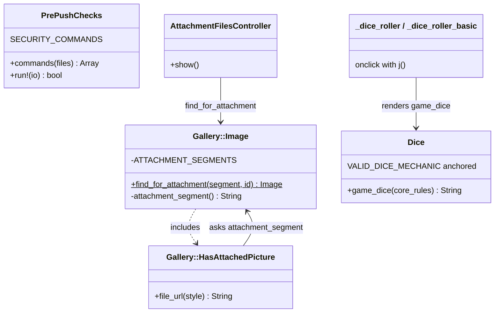
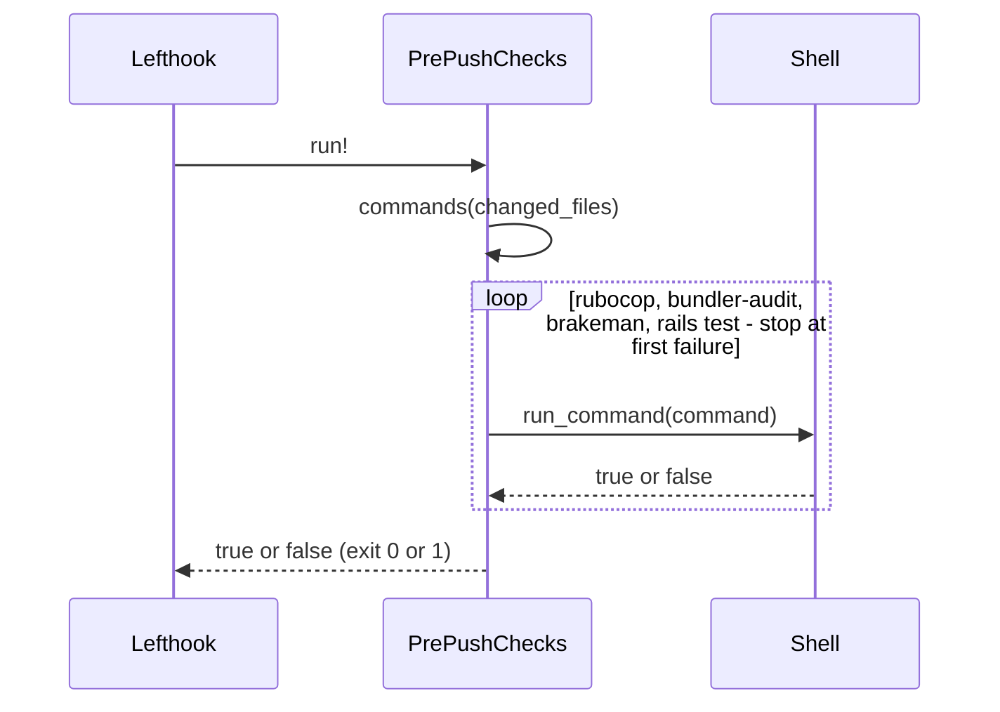

# Plan: Security checks block pushes and pull requests

From `intent.md` (2026-11-08). Status: accepted.

## Departure from this plan (2026-11-14)

PR #167 (`fix-security-audit-findings`) landed on main during implementation. It fixed the 8 Brakeman warnings: anchored `VALID_DICE_MECHANIC`, `Gallery::Image.find_in_collection`, and the `ErrorsController` removal. Order of work steps 1, 2, 4 and 5 are therefore dropped, with the `find_for_attachment` design and its Proof lines and the glossary commit. Main's Brakeman run is already clean.

This change keeps: the `j` escaping of both dice roller partials (step 3), the `PrePushChecks` security commands (step 6), `ignore: []` (step 7) and the `security` CI job (step 8). Etienne chose this on 2026-11-14.

## Context

Nothing stops a gem version with a known advisory, or code with a known security weakness, from reaching main. CI (`.github/workflows/ci.yml`) and `bin/pre_push_checks` (`lib/pre_push_checks.rb`) run neither bundler-audit nor Brakeman. bundler-audit is clean on main today. Brakeman 8.1.0 reports 8 warnings. This change fixes all 8 in code, then makes both security checks block every push and every pull request, with no reviewed exceptions.

Triage of the 8 warnings (done in the plan stage, verified against the code):

- Format Validation ×6 (`ability_score.rb`, `attack.rb`, `base_value.rb`, `movement.rb`, `saving_throw.rb`, `skill.rb`): a real stored XSS. `Dice::VALID_DICE_MECHANIC` (`app/models/concerns/dice.rb`) anchors only its first alternative, so `Standard'); alert(1);//` validates. `skills/layouts/_sheet.html.erb` passes `skill.game_dice(...)` into `app/views/layouts/_dice_roller.html.erb`, which writes it into an inline `onclick="roll_them_bones('…', '<%= dice %>', …)"`. The browser HTML-decodes `&#39;` back to `'` before the JavaScript runs.
- Dynamic Render Path, `app/controllers/errors_controller.rb:5`: not a real risk. No route reaches `ErrorsController`, and `exceptions_app` is not set. It is dead code. Its views `app/views/errors/403.html.erb` and `404.html.erb` are rendered by ten other controller call sites through `render template: 'errors/40x'`, so they stay.
- Remote Code Execution (UnsafeReflection), `app/controllers/attachment_files_controller.rb:21`: not a real risk. `constantize` reads only values of the frozen allowlist `Gallery::Image::ATTACHMENT_SEGMENTS`. The fix removes the reflection anyway, so no reviewed exception is needed.

## Design

### Domain terms

- **Dice mechanic** (new, agreed for the glossary): a stored dice value — a dice expression such as `2d6+1d4`, or exactly `Standard`, `Fate` or `Roll Under`.
- **Security check** (intent wording, not a glossary term): a bundler-audit or Brakeman run that fails a push or a pull request when it finds a problem.
- **Reviewed exception** (intent wording, not a glossary term): an advisory or warning recorded as not a real risk, with the reason. This change records none.
- **Attachment segment** (code wording only): the path segment that names a gallery image collection, such as `stock_images` in `/attachments/gallery/stock_images/<id>/thumb`.

There is no `GLOSSARY.md` yet. No word in the intent or this plan is on an avoid list.

### Diagrams

Touched objects after the change:



Push gate:



Not affected: ER diagram — no table, column or data changes.

### Signatures

**`Dice`** (`app/models/concerns/dice.rb`) gives an entitybuilder record its dice mechanic. Only the constant changes:

```ruby
VALID_DICE_MECHANIC = /\A(?:[0-9]+d[0-9]+(?:\+*[0-9]+d[0-9]+)*|Standard|Fate|Roll Under)\z/ #: Regexp
```

The six entitybuilder models keep their `validates … format: { with: VALID_DICE_MECHANIC }` lines unchanged. The regex stays a literal, so Brakeman can read it.

**`layouts/_dice_roller.html.erb`** and **`layouts/_dice_roller_basic.html.erb`** render a dice roll link. The `onclick` becomes `roll_them_bones('<%= j core_rules %>', '<%= j dice %>', '<%= j bonus %>');`. `j` (`escape_javascript`) escapes for JavaScript, then ERB escapes for HTML: the right order for an attribute the browser HTML-decodes before it runs the script. `escape_javascript` calls `to_s` first, so an Integer `bonus` is safe. A valid dice mechanic holds no character `j` changes, so the HTML stays byte-identical.

**`Gallery::Image`** (`engines/gallery/app/models/gallery/image.rb`) is a stored gallery picture, the STI parent of the four collection types. It owns the mapping between attachment segment and type.

```ruby
ATTACHMENT_SEGMENTS = { "faq_images" => "Gallery::FaqImage", … }.freeze #: Hash[String, String]
private_constant :ATTACHMENT_SEGMENTS

# Finds the image the attachment segment and id name; nil, with no query, when the segment is unknown.
#: (String segment, id: String) -> Gallery::Image?
def self.find_for_attachment(segment, id:)

private

#: () -> String?
def attachment_segment
```

`find_for_attachment` runs `find_by(id: id, type: ATTACHMENT_SEGMENTS[segment])` only when the segment is known. ActiveRecord builds the right subclass from the stored `type` (`gallery_images.type` is `null: false`). No subclass constant is named in the class body, so Zeitwerk load order does not change.

**`Gallery::HasAttachedPicture`** gives an image its stored file and variant URLs. Public interface unchanged. `file_url(style)` builds the path from `attachment_segment` instead of reading the constant.

**`AttachmentFilesController`** streams one gallery image variant to a viewer who may see it. Public interface unchanged. The private `attachment_record` matches `[ "gallery", collection_name, id, _ ]` and calls `Gallery::Image.find_for_attachment(collection_name, id: id)`.

**`ErrorsController`**: deleted, with `test/controllers/errors_controller_test.rb` (only commented-out tests).

**`PrePushChecks`** (`lib/pre_push_checks.rb`) runs the checks a push must pass. No new public method.

```ruby
SECURITY_COMMANDS = [
  ["bin/bundler-audit", "check", "--update"],
  ["bin/brakeman", "--no-pager", "--quiet"]
].freeze #: Array[Array[String]]

# Lists the commands for the changed files: rubocop when Ruby changed, both security checks always, rails test when tests changed.
#: (Array[String] files) -> Array[Array[String]]
def commands(files)

# Reports skipped checks, then runs commands(changed_files) in order and stops at the first failure.
#: (?io: IO) -> bool
def run!(io: $stdout)
```

`run!` becomes `report_skipped_checks(files, io:)` plus `commands(files).all? { |command| run_command(command, io: io) }`. This removes today's copy of the selection logic in `run!`. `report_skipped_checks` is private (`private_class_method`, since the module uses `module_function`). Brakeman exits non-zero on warnings by default (`--[no-]exit-on-warn … (Default)` in `bin/brakeman --help`).

**CI** (`.github/workflows/ci.yml`): a new job `security`, with `actions/checkout@v4`, `spinel-coop/setup-rv@main` (`ruby-version: current`, `install-gems: true`) like `lint_ruby`, then `bin/bundler-audit check --update` and `bin/brakeman --no-pager --quiet`. No database, Node or Chrome.

**Config**: `.bundler-audit.yml` keeps its comment header and becomes `ignore: []`. There is no `config/brakeman.ignore`.

Not checked: the project has no Steep or rbs_rails. The `#:` comments above document the signatures.

### Complexity

- `Gallery::Image.find_for_attachment`: 0 queries for an unknown segment, 1 for a known one. Today it is 0 and 1 as well.
- `file_url`: a reverse lookup in a 4-entry hash, no query. Same as today.
- `VALID_DICE_MECHANIC`: linear in the value length, which `length: { maximum: 255 }` caps.
- `j` on three short strings per roller: negligible.
- Pre-push: every push adds a bundler-audit run (a few seconds, with a network fetch of the advisory database) and a full Brakeman scan (about 7 seconds today), whatever the diff.
- CI: one more parallel job, about as long as `lint_ruby`. It does not lengthen the critical path (`test`).

### Invariants

- A stored dice mechanic is a dice expression or exactly `Standard`, `Fate` or `Roll Under`. Enforced by the format validation on the six models through `Dice::VALID_DICE_MECHANIC`.
- A value in a dice roller `onclick` cannot leave its JavaScript string. Enforced by `j` in both roller partials.
- No text from a request reaches `constantize`; only the four allowlisted types are queried. Enforced by the guard in `Gallery::Image.find_for_attachment`.
- The segment-to-type mapping lives in one place. Enforced by `private_constant :ATTACHMENT_SEGMENTS`.
- Every push runs both security checks, whatever files changed, and fails when either fails. Enforced by `PrePushChecks.commands` and `run!`.
- Every pull request runs both security checks and fails when either fails. Enforced by the `security` job in `ci.yml`.
- Brakeman reports zero warnings, and neither tool has a reviewed exception. Enforced by the two checks themselves, with no `config/brakeman.ignore` and `ignore: []`.

### Alternatives

- **Chosen — fix all eight in code, escape the rollers.** Zero reviewed exceptions; the real XSS is closed at write time (validation) and at render time (escaping), so payloads already stored are harmless too.
- **Rejected — anchor the regex, record two reviewed exceptions in `config/brakeman.ignore`.** Smallest diff, but the ignored fingerprint on `ErrorsController` stays silent if someone routes it later, and stored payloads stay exploitable.
- **Rejected — the chosen design plus a data migration that strips or nulls invalid stored dice values.** Irreversible change to production rows; some sheets would fall back to default dice. The `j` escaping already neutralises stored payloads.

## Design decisions

- Fixes and checks land in one change and one pull request. The fix commits come first and the switch-on commits last, so every commit stays green. This settles the intent's open question on splitting.
- `test/lib/bundler_audit_config_test.rb` is deleted. It asserted the placeholder, and with `ignore: []` an `assert_empty` would also pass when the file is missing, so it would prove nothing. The playbook says configuration gets no tests.
- No test for `ci.yml`. It is configuration. `test/lib/ci_workflow_test.rb` stays as it is.
- Pre-push uses `check --update`, so a push needs network access and a stale local advisory database cannot pass. CI uses the same flag.
- Security checks run on every push, also a docs-only push, as the intent requires.
- Command order in `commands`: rubocop, bundler-audit, Brakeman, rails test — cheap checks first.
- No data migration (design gate). Stricter validation means a record that already holds text around a mechanic name (for example `Fate roll` or `Standard ` with a trailing space) fails validation on its next edit until the user corrects the dice field. Etienne did not ask for a data check first; this is recorded as a risk.
- Hardening other dice sinks that Brakeman does not report (`Entitybuilder::EntitiesHelper#format_dice_popup`, `#format_dice_activeplay`, `AttackProfileHelper#attack_display_profile`, which build `.html_safe` strings) is out of scope. The anchored validation already limits what new values can reach them. Propose a follow-up change.
- Marking `security` as a required status check on `main` is a GitHub setting outside the repository. Etienne does it after merge.
- The intent has no `## Decisions` section, so there is nothing to check against.

## Integration points

- lefthook `pre-push` (`lefthook.yml`) runs `rv run bin/pre_push_checks`; unchanged.
- Binstubs `bin/brakeman` (brakeman 8.1.0) and `bin/bundler-audit` (bundler-audit 0.9.3); unchanged.
- ruby-advisory-db over the network (`--update`).
- GitHub Actions (`ci.yml`).
- `roll_them_bones` in `app/assets/javascripts/roller/roll_them_bones.js`; unchanged, it receives the same arguments.
- The gallery attachment route `/attachments/*path` (`config/routes.rb:30`); unchanged.

## Files that change

- `app/models/concerns/dice.rb` — anchor `VALID_DICE_MECHANIC`.
- `test/models/dice_test.rb` — regression tests for the validation.
- `app/views/layouts/_dice_roller.html.erb`, `app/views/layouts/_dice_roller_basic.html.erb` — `j` in `onclick`.
- `test/views/layouts/dice_roller_test.rb` (new) — render tests for both partials.
- `engines/gallery/app/models/gallery/image.rb` — `find_for_attachment`, private constant, private `attachment_segment`.
- `engines/gallery/app/models/concerns/gallery/has_attached_picture.rb` — `file_url` uses `attachment_segment`.
- `test/models/gallery/image_test.rb` — unit tests for `find_for_attachment` and the round trip.
- `app/controllers/attachment_files_controller.rb` — call `find_for_attachment`.
- `app/controllers/errors_controller.rb`, `test/controllers/errors_controller_test.rb` — deleted.
- `lib/pre_push_checks.rb`, `test/lib/pre_push_checks_test.rb` — security commands.
- `.bundler-audit.yml` — `ignore: []`.
- `test/lib/bundler_audit_config_test.rb` — deleted.
- `.github/workflows/ci.yml` — new `security` job. Accepting this plan is Etienne's explicit approval for exactly this job and nothing else in `.github/`.
- `GLOSSARY.md` (new, at plan acceptance) — the term Dice mechanic.

Out of scope: data migrations, other dice sinks, `ErrorsHelper` and `errors.scss`, GitHub branch-protection settings, `lefthook.yml`, the binstubs.

## Order of work

1. Write the regression test for the dice XSS in `test/models/dice_test.rb` (the first acceptance criterion: each warning is fixed). Run it, watch it fail on the payload.
2. Anchor `VALID_DICE_MECHANIC`. Run `test/models/dice_test.rb` green, then `bin/brakeman --no-pager --quiet` and confirm the six Format Validation warnings are gone. Commit.
3. Write `test/views/layouts/dice_roller_test.rb`; watch the payload case fail. Add `j` to both partials; green. Commit.
4. Write the `Gallery::Image.find_for_attachment` tests in `test/models/gallery/image_test.rb`; watch them fail. Add the method, `private_constant` and `attachment_segment`; switch `file_url` and `AttachmentFilesController` to them. Run `test/models/gallery/` and `test/integration/attachment_files_test.rb` green. Commit.
5. Delete `ErrorsController` and its test. Run `bin/brakeman --no-pager --quiet`: expect "No warnings found" and exit 0. Commit.
6. Write the new `PrePushChecks` tests; watch them fail. Add `SECURITY_COMMANDS`, update `commands` and `run!`. Green. Commit.
7. Set `.bundler-audit.yml` to `ignore: []` and delete `bundler_audit_config_test.rb`. Run `bin/bundler-audit check --update`: exit 0. Commit.
8. Add the `security` job to `ci.yml`. Commit.
9. Run `bin/pre_push_checks`, `bundle exec rubocop`, then the full `bin/rails test` and `bin/rails test:system`. Push; confirm the `security` job is green on the pull request.

## Risks

- Stricter dice validation rejects stored values with extra text on their next edit (see Design decisions). Medium likelihood, low harm: the user sees a validation error on the dice field.
- `--update` blocks a push when offline or when the advisory database host is down. Accepted.
- A new advisory or a new Brakeman check can block a push that did not touch the affected code. Intended.
- Brakeman's anchor check must accept `\A(?:…)\z`. Step 2 proves it with a real run.
- `private_constant :ATTACHMENT_SEGMENTS` breaks any other reader. A search finds only the two readers this plan rewrites.
- Merges are blocked only once `security` is a required check in GitHub's branch settings.

## Proof

- A push fails when bundler-audit finds an advisory → `test/lib/pre_push_checks_test.rb` `.run! stops when bundler-audit fails`
- A push fails when Brakeman finds a warning → `test/lib/pre_push_checks_test.rb` `.run! stops when brakeman fails`
- Both security checks run on every push, also a docs-only one → `test/lib/pre_push_checks_test.rb` `.commands includes both security checks when only docs change`
- A pull request fails when either check fails → check: the `security` job runs `bin/bundler-audit check --update` and `bin/brakeman --no-pager --quiet` and is green on this change's pull request
- Each of today's 8 Brakeman warnings is fixed → check: `bin/brakeman --no-pager --quiet` prints "No warnings found" and exits 0; `config/brakeman.ignore` does not exist
- bundler-audit starts with no exceptions; the placeholder goes → check: `.bundler-audit.yml` holds `ignore: []`; `bin/bundler-audit check --update` exits 0
- Fixes do not change what users see, except the real vulnerability → `test/views/layouts/dice_roller_test.rb` `renders a valid dice mechanic unchanged`, and `test/integration/attachment_files_test.rb` stays green
- Query count: `find_for_attachment` runs 0 queries for an unknown segment and 1 for a known one → `test/models/gallery/image_test.rb` `find_for_attachment runs no query for an unknown segment`, `find_for_attachment runs one query for a known segment`
- Invariant: a stored dice mechanic is a dice expression or exactly a core mechanic, enforced by the six model validations → `test/models/dice_test.rb` `each dice model rejects text around a core mechanic`
- Invariant: a roller value cannot leave its JavaScript string, enforced by `j` in both partials → `test/views/layouts/dice_roller_test.rb` `escapes a quote in dice for both partials`
- Invariant: only allowlisted types are queried, enforced by `find_for_attachment` → `test/models/gallery/image_test.rb` `find_for_attachment returns nil for an unknown segment`
- Invariant: one place maps segment to type, enforced by `private_constant` → `test/models/gallery/image_test.rb` `file_url segment leads find_for_attachment back to the image`

Per changed file, the unit tests expected, named as behaviour:
- `app/models/concerns/dice.rb`: `VALID_DICE_MECHANIC accepts dice expressions` (`1d20`, `2d6+1d4`), `accepts each core mechanic exactly` (`Standard`, `Fate`, `Roll Under`), `rejects text around a core mechanic` (`Standard'); alert(1);//`, `x Fate`, `Fate roll`, `Standard ` with a trailing space, `Fate\n<script>`), `each dice model rejects text around a core mechanic` (AbilityScore, Attack `attack_dice`, BaseValue, Movement, SavingThrow, Skill — `valid?` then an error on the attribute).
- `app/views/layouts/_dice_roller.html.erb`, `_dice_roller_basic.html.erb`: `escapes a quote in dice for both partials` (the Nokogiri-decoded `onclick` holds `\'`), `renders a valid dice mechanic unchanged` (`2d6`: `onclick` equals `roll_them_bones('dnd5e', '2d6', '3');`).
- `engines/gallery/app/models/gallery/image.rb`: `find_for_attachment returns the subclass for a known segment` (`stock_images` + `stock_one` → `Gallery::StockImage`), `returns nil for an unknown segment`, `returns nil when the id belongs to another collection` (`stock_images` + `resident_one`), the two query-count tests.
- `engines/gallery/app/models/concerns/gallery/has_attached_picture.rb`: `file_url segment leads find_for_attachment back to the image`.
- `app/controllers/attachment_files_controller.rb`: covered by the existing `test/integration/attachment_files_test.rb`.
- `lib/pre_push_checks.rb`: `.commands includes both security checks when only docs change`, the existing `.commands` test updated to the new order, `.run! stops when bundler-audit fails`, `.run! stops when brakeman fails`; the existing "reports skipped checks" test stubs `run_command` so it does not run the real tools.

Test setup: existing fixtures `test/fixtures/gallery/images.yml` (`stock_one`, `resident_one`) and the entitybuilder fixtures; `PrePushChecks` tests stub `changed_files` and `run_command` with the existing `with_replaced_method` helper; the view test is an `ActionView::TestCase` rendering the partials with locals; query counts use `assert_queries_count` / `assert_no_queries`.

---
Domain skills applied: rails-architecture, object-oriented-design, software-design, rails-testing, rails-ui, brakeman, glossary, diagrams.
