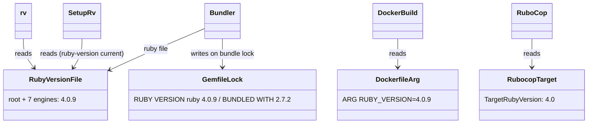
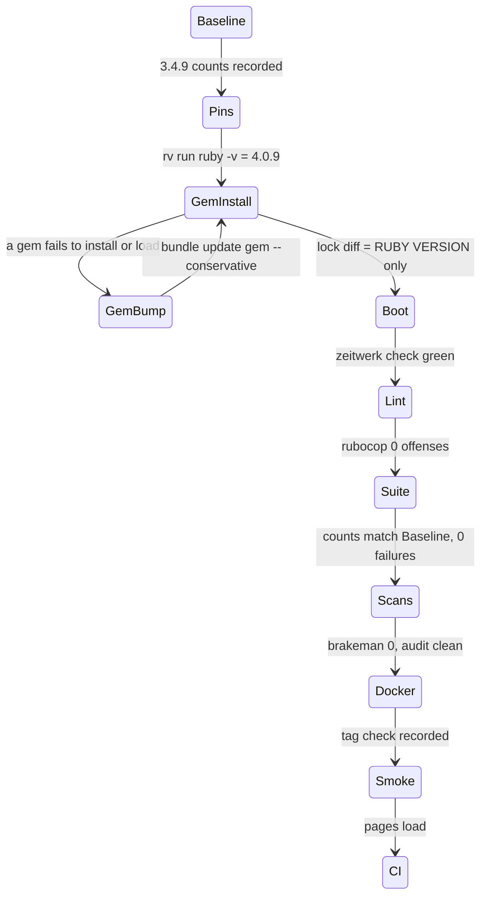

# Plan: Upgrade Ruby to 4.0.9

From `intent.md` (2026-11-19). Status: accepted.

## Design

### Domain terms

- **Ruby pin**: a file line that names the Ruby version a tool installs or targets. The pins are the eight `.ruby-version` files, the root `Gemfile.lock` `RUBY VERSION`, the `Dockerfile` `ARG RUBY_VERSION` and the `.rubocop.yml` `TargetRubyVersion`.
- **Pin reader**: the tool that reads a Ruby pin: rv (local), `spinel-coop/setup-rv` (CI), Bundler (`ruby file: ".ruby-version"`), the Docker build and RuboCop.
- **Gate**: the verification command after a step. The next step starts only when the gate is green.
- **Baseline**: the test counts and check results on Ruby 3.4.9 before any edit. CI on `main` at `fb8e301` is green and is the remote baseline.

These are plan vocabulary, not domain terms. `GLOSSARY.md` holds only gallery and dice terms, and nothing in `intent.md` conflicts with it. No glossary entry is added.

### Diagrams

Before and after differ only in the version each pin names (3.4.9 → 4.0.9, target 3.4 → 4.0).

Gate order:

### Signatures

Not affected: the change touches no Ruby class and adds no method. A Ruby 4 break found during the suite run gets its fix and its signature in the commit that fixes it.

Not checked: cityofbrass has neither Steep nor rbs_rails in its Gemfile.

### Complexity

Not affected: no request path and no query changes. The first CI run has a cold gem cache, because the setup-rv cache key includes the Ruby version.

### Invariants

- All eight `.ruby-version` files read `4.0.9`. Enforced by the pin gate (`cat .ruby-version engines/*/.ruby-version | sort -u`).
- The root `Gemfile.lock` `RUBY VERSION` matches the root `.ruby-version`. Bundler enforces it through `ruby file: ".ruby-version"`.
- `Gemfile.lock` changes only in `RUBY VERSION` and in single-gem bumps that Ruby 4.0.9 forces. Enforced by `git diff Gemfile.lock` before every commit. `engines/importer/Gemfile.lock` changes in `RUBY VERSION` only, or not at all.
- Engines with a `.ruby-version` of 3.4.0 or newer declare `drb`. `test/engine_gemfile_test.rb` enforces it; it still holds at 4.0.9, so the test does not change.
- Every Baseline test still runs on 4.0.9, with 0 failures, 0 errors and no new skips. A regression test added for a Ruby 4 break may raise the run count. Enforced by the suite gate.

### Alternatives

1. **Minimal diff** (pins only, verify at the end). Chosen for the file set: 11 files, about 11 changed lines. Rejected as the only approach: a break shows up only at the end, mixed with every other failure.
2. **Fail fast with parity** (gate after every step, Baseline on 3.4.9, sorted test-name diff with a fixed seed). Chosen for the order of work and the gates. Its full sorted-name diff with a fixed `SEED` and two system-test runs per Ruby is dropped: CI on `main` is already green, so comparing run, assertion and skip counts is enough proof of parity at half the run time.
3. **Single source for the version** (derive the Dockerfile ARG from `.ruby-version` at build time, drop engine pins). Rejected: it changes deploy and build config beyond the two approved one-line edits, and removing engine pins is a refactor the intent puts out of scope.

## Design decisions

- **One pin commit.** All pins (eight `.ruby-version` files, `Gemfile.lock`, `Dockerfile`, `.rubocop.yml`) change in one commit. Drift between `.ruby-version` and the Docker image is the most common deploy failure of a Ruby major. Code or gem fixes follow as their own commits.
- **`BUNDLED WITH` stays `2.7.2`.** Bundler 2.7.2 is installed for Ruby 4.0.9, and Bundler auto-switches to the locked version. Moving to Bundler 4 is a separate upgrade the intent puts out of scope. If `bundle lock` rewrites the line, restore it to `2.7.2`; if Bundler 2.7.2 then fails on Ruby 4.0.9, bump it with `rv run bundle update --bundler` as a forced bump and record why.
- **`engines/importer/Gemfile.lock` gets its Ruby metadata only if that stays a one-line change.** It records `ruby 3.4.9` and evaluates the root Gemfile through `eval_gemfile`, so after the importer pin moves its metadata conflicts. But it is already stale (rails 8.1.3.1 against the root's 8.1.4.1, `BUNDLED WITH 4.0.11`), and CI never reads it. Step 6 runs `rv run bundle lock` in `engines/importer` and keeps the result only when the diff is the `RUBY VERSION` line alone. Any other changed line means drift sync, which bumps gems beyond what Ruby forces: revert the file and record it as a leftover 3.4 pin for a separate change. Update 2026-11-20: Etienne put the engines in scope after delivery. `bundle lock` moved `BUNDLED WITH` to 4.0.24 and nothing else, so that line was restored to 4.0.11 and the file changes in `RUBY VERSION` alone. No other engine lockfile records a Ruby version.
- **No new tests for the pins.** The pins are configuration; the checks in `## Proof` prove them. Only a code fix gets a test, and as a bug fix its regression test comes first.
- **`ruby -v` acceptance runs through rv.** In a shell without rv activation, bare `ruby` is macOS system Ruby 2.6. The checks use `rv run ruby -v` and `rv run bundle exec ruby -v`, which read `.ruby-version` like `cd` activation does.
- **Docker image is checked, not built.** No Docker runtime exists on this machine. The check records that `ruby:4.0.9-slim` exists on Docker Hub, and that the build itself is unverified until deploy.

No conflict with `intent.md` `## Decisions`: the `Dockerfile` and `.rubocop.yml` edits are the approved one-line edits, delivery stays autonomous with Claude review only, and the branch starts from `main`.

## Integration points

- rv locally: `rv run` reads `.ruby-version`. Ruby 4.0.9 is installed at `~/.local/share/rv/rubies/ruby-4.0.9`; gems go to `~/.local/share/rv/gems/ruby/4.0.0`, where sassc 2.4.0, symbol-fstring 1.0.2, debug_inspector 1.2.0, ed25519 1.4.0 and redcarpet 3.6.1 already built for Ruby 4.0.
- `bi` (`~/.local/bin/bi`): runs `bundle lock`, then `rv ci`, then `yes n | bin/rails app:update:bin`. Run it as `rv run bi` so `bundle` is the rv Ruby's Bundler, not `/usr/bin/bundle`.
- CI (`.github/workflows/ci.yml`): every job uses `spinel-coop/setup-rv@main` with `ruby-version: current`, which reads `.ruby-version`. No workflow edit is needed. The jobs are RuboCop, `bin/rails test`, `bin/rails test:system` and `bin/i18n-tasks health`.
- Docker (`Dockerfile`): `FROM registry.docker.com/library/ruby:$RUBY_VERSION-slim`. The tag `4.0.9-slim` exists (Docker Hub API returned 200 on 2026-11-19). The build runs `bundle lock --add-platform x86_64-linux` and `bundle install` with Bundler auto-switching to the locked 2.7.2, the same mechanism it uses on 3.4.9 today.
- RuboCop 1.92: its `KNOWN_RUBIES` includes 4.0.
- Rails 8.1.4.1 supports Ruby 4.0.

Ruby 4.0 risk sweep (from the `ruby-upgrade` skill's change list), already done against `app`, `lib`, `config`, `engines`, `test`, `bin`:

| Change | Exposure | Action |
|---|---|---|
| 01 Net::HTTP implicit Content-Type | none | none |
| 02 CGI.parse / CGI::Cookie removed | none | none |
| 03 default gems demoted | `logger`, `ostruct`, `benchmark`, `reline`, `base64`, `bigdecimal`, `drb`, `mutex_m` already in Gemfile; `irb`, `rdoc` resolved transitively | none |
| 04 SortedSet removed | none | none |
| 05 Set#inspect format | no `#<Set:` assertions | none |
| 06 pipe `open("\|...")` | none | none |
| 07 Process::Status bit ops | none | none |
| 08 OpenSSL 4 | no `openssl` pin | none |
| 09 native-extension recompile | native gems listed above; sqlite3 2.10.2 compiles from source (`force_ruby_platform`) | covered by the install gate |
| 10 backtrace format | exception_notification only | post-deploy watch |
| 11 Ractor | none | none |
| 13 URI.escape | none | none |
| 14 ZJIT | not enabled | keep as is |

## Files that change

- `.ruby-version` — `3.4.9` → `4.0.9`.
- `engines/billing/.ruby-version`, `engines/entitybuilder/.ruby-version`, `engines/gallery/.ruby-version`, `engines/importer/.ruby-version`, `engines/report/.ruby-version`, `engines/rulebuilder/.ruby-version`, `engines/worldbuilder/.ruby-version` — `3.4.9` → `4.0.9`.
- `Gemfile.lock` — `RUBY VERSION` → `ruby 4.0.9` with its patch level, written by `bundle lock`. Never edit it by hand. A gem line changes only through a forced `bundle update <gem> --conservative`.
- `engines/importer/Gemfile.lock` — `RUBY VERSION` → `ruby 4.0.9`, only if `bundle lock` changes that line alone (step 6). Otherwise untouched.
- `Dockerfile` line 3 — `ARG RUBY_VERSION=4.0.9`.
- `.rubocop.yml` line 19 — `TargetRubyVersion: 4.0`.
- Production code or a single gem, only if a gate shows a Ruby 4.0.9 break. Each such fix is its own commit with its own regression test.

Out of scope, never touched: `.github/workflows/`, `config/deploy.yml`, the other engine lockfiles (they record no Ruby version), any `engines/importer/Gemfile.lock` line besides `RUBY VERSION`, `test/engine_gemfile_test.rb`, Gemfile comments, `BUNDLED WITH` (unless forced, see Design decisions), the `@rails/actiontext` alignment, Ruby 4 language features, any refactor.

## Order of work

No acceptance criterion needs a new test, so step 1 is the Baseline, not a failing test.

1. **Baseline on 3.4.9**, before any edit. Prepare the test database with `rv run bin/rails db:test:prepare`. Run `DISABLE_SPRING=1 rv run bin/rails test` and `DISABLE_SPRING=1 rv run bin/rails test:system`. Record the runs, assertions, failures, errors and skips of each in a scratchpad file. A failure here is pre-existing: stop and report it (playbook rule 25), do not fix it in this branch.
2. **Root pin.** Write `4.0.9` to `.ruby-version`. Gate: `rv run ruby -v` prints `ruby 4.0.9`.
3. **Gems.** Run `rv run bi`. Gates, in order:
   - `rv run bundle exec ruby -v` prints `ruby 4.0.9`.
   - `git diff Gemfile.lock` shows only the `RUBY VERSION` line. Restore `BUNDLED WITH 2.7.2` if it moved (see Design decisions).
   - `git status` shows no `bin/` change from `bin/rails app:update:bin`. Revert any.
   - A gem that fails to install or load: `bundle lock` already resolved, so the pin diff stays clean. Commit the pins first (step 7 brings that commit forward), then read the error and run `rv run bundle update <gem> --conservative`. Commit that bump alone, with the reason in its message, and re-run this step.
   - Resolution itself fails (a gem declares `required_ruby_version < 4`): the one-gem bump goes into the pin commit, and its message names the gem and the reason. This is the only non-pin hunk the pin commit may hold.
   - Removing or replacing a gem stops the work: ask Etienne.
4. **Boot.** Gates: `DISABLE_SPRING=1 rv run bin/rails runner -e test 'puts RUBY_VERSION'` prints `4.0.9`, then `DISABLE_SPRING=1 rv run bin/rails zeitwerk:check` reports all is good. Eager load reaches every engine before any test runs.
5. **RuboCop target.** Set `.rubocop.yml` `TargetRubyVersion: 4.0`. Gate: `rv run bundle exec rubocop` reports no offenses. An offense is fixed in the code, never with a disable comment or a config edit.
6. **Engine pins and Docker.** Write `4.0.9` to the seven engine `.ruby-version` files and set `Dockerfile` `ARG RUBY_VERSION=4.0.9`. Then run `rv run bundle lock` inside `engines/importer` and keep its `Gemfile.lock` change only when `git diff engines/importer/Gemfile.lock` is the `RUBY VERSION` line alone; otherwise `git checkout engines/importer/Gemfile.lock` and record it (see Design decisions). Gate: `cat .ruby-version engines/*/.ruby-version | sort -u` prints only `4.0.9`, and `grep -n 'ARG RUBY_VERSION' Dockerfile` prints `4.0.9`.
7. **Commit the pins** as one commit: `.ruby-version` ×8, `Gemfile.lock`, `Dockerfile`, `.rubocop.yml`, and `engines/importer/Gemfile.lock` if step 6 kept it. Re-read the full diff first; every hunk is a pin, except a resolution-forced gem bump from step 3.
8. **Suite.** Run one fast test file first, for example `DISABLE_SPRING=1 rv run bin/rails test test/engine_gemfile_test.rb`. Then `DISABLE_SPRING=1 rv run bin/rails test` and `DISABLE_SPRING=1 rv run bin/rails test:system`, with `--fail-fast` while fixing. Gate: 0 failures, 0 errors, every Baseline test still runs, and no test skips that did not skip in the Baseline. The run count may only grow by regression tests this change adds.
   - A test that passed in the Baseline and fails now is a Ruby 4 break. That test is the regression test, already red. Fix the production code (or bump one gem), one commit per break, re-run that file, then the whole suite.
   - Stop after three failed attempts at one break and record it as a blocker.
9. **Scans.** Gates: `rv run bundle exec brakeman` reports 0 warnings; `rv run bundle exec bundler-audit check --update` reports no vulnerabilities; `rv run bin/i18n-tasks health` is green. No Brakeman ignore.
10. **Docker check.** No Docker runtime exists here. Run `curl -s -o /dev/null -w '%{http_code}' https://hub.docker.com/v2/repositories/library/ruby/tags/4.0.9-slim` and record the result, plus the statement that `docker build` did not run and the build is first proven at deploy.
11. **Smoke test.** The worktree has no development database. Prepare one with `rv run bin/setup --skip-server` (non-destructive `db:prepare` and seeds). Start `rv run bin/dev`. Load the home page `/`, sign in at `/login` as `user@example.com` / `password1`, upload a picture in the gallery (`/gallery`) and load it. Record each HTTP status and that the picture renders. Stop the server.
12. **Self-review** the full diff against `main`, then push the branch. CI runs only on pull requests and on pushes to `main` (`.github/workflows/ci.yml` lines 3–6), so a branch push starts no CI run. The CI check belongs to delivery: after the Claude review, `deliver` opens the draft pull request, and its CI run must show Ruby 4.0.9 in the setup-rv step of every job, with every job green. If setup-rv does not pick up 4.0.9, report it; do not edit the workflow.

## Risks

- **Docker build unproven.** The `ruby:4.0.9-slim` build, Bundler auto-switch to 2.7.2 inside it, and the sqlite3 source compile on Linux are first exercised at deploy. CI does not build the image. Mitigation: the tag check, and the same auto-switch path the 3.4.9 image uses today.
- **A gem fails at load, not at install.** A gem may `require` a library that Ruby 4.0 moved to a bundled gem without declaring it. The boot gate and the suite catch it; the fix is a one-gem bump or, if none exists, a question to Etienne.
- **`bi` side effects.** `bi` runs `bin/rails app:update:bin`; `yes n` declines overwrites, but a new binstub could appear. The gem gate reverts it.
- **Error-tracker fingerprint drift** (exception_notification) after deploy: backtrace formats change in Ruby 4.0. Expect new groupings for about a day.
- **Rejected:** a sorted test-name diff with a fixed seed (count parity plus green CI on `main` is enough); deriving the Docker version from `.ruby-version` (needs unapproved build-config edits); a full drift sync of `engines/importer/Gemfile.lock` (bumps gems beyond what Ruby forces).

## Proof

- `ruby -v` reports 4.0.9, and `bundle exec ruby -v` agrees → check: `rv run ruby -v` and `rv run bundle exec ruby -v` both print `ruby 4.0.9`.
- `bin/rails test` passes on 4.0.9 locally and in CI → check: `DISABLE_SPRING=1 rv run bin/rails test` and `DISABLE_SPRING=1 rv run bin/rails test:system` report 0 failures and 0 errors, every Baseline test still runs and no new test skips; the CI `Test` job on the draft pull request that `deliver` opens is green and its setup-rv step reports 4.0.9.
- RuboCop reports no offenses with `TargetRubyVersion` 4.0 → check: `rv run bundle exec rubocop`.
- Brakeman reports 0 warnings and bundler-audit reports no vulnerabilities → check: `rv run bundle exec brakeman` and `rv run bundle exec bundler-audit check --update`.
- The Docker image builds with 4.0.9, or is checked as far as the environment allows → check: the Docker Hub tag request for `ruby:4.0.9-slim` returns 200; record that `docker build` did not run.
- The app starts with `bin/dev`, and the home page, sign-in and a gallery picture load → check: manual smoke test of step 11, with each HTTP status recorded.
- All eight `.ruby-version` files and the `Dockerfile` default read 4.0.9 → check: `cat .ruby-version engines/*/.ruby-version | sort -u` prints only `4.0.9`; `grep -n 'ARG RUBY_VERSION' Dockerfile` prints `ARG RUBY_VERSION=4.0.9`.
- Invariant: `Gemfile.lock` changes only in `RUBY VERSION` and forced single-gem bumps, enforced by the gem gate → check: `git diff main -- Gemfile.lock`.
- Invariant: engines with a 3.4+ pin declare `drb`, enforced by `test/engine_gemfile_test.rb` → `test/engine_gemfile_test.rb` `test_ruby_34_engines_include_drb`.

Per changed file, the unit tests expected:
- `.ruby-version` ×8, `Gemfile.lock`, `Dockerfile`, `.rubocop.yml`: none; configuration has no tests.
- Any production file a Ruby 4 break forces to change: the existing test that went red names the behaviour; if no test covers the break, write one first that fails on 4.0.9.

Test setup: existing fixtures and system-test setup (Cuprite, local Chrome). `DISABLE_SPRING=1` on every Rails command, as CI does. No new fixtures.

---
Domain skills applied: ruby-upgrade, dependencies, software-design, glossary, diagrams.

## Critique

### Round 1 (codex gpt-6.1-sol)

- Step 12 cannot get CI results from a branch push, because `ci.yml` runs on pull requests and pushes to `main` only → fixed (step 12 and the test Proof line move the CI check to the draft pull request that `deliver` opens after the Claude review)
- Leaving `engines/importer/Gemfile.lock` at Ruby 3.4.9 conflicts with its updated pin, and updating its Ruby metadata does not need gem upgrades → fixed (step 6 runs `bundle lock` in `engines/importer` and keeps the change only when the diff is the `RUBY VERSION` line alone; otherwise it reverts and records the leftover pin)
- A forced gem update cannot pass a gate that demands a lockfile diff of `RUBY VERSION` alone and a pin-only commit → fixed (step 3 commits the pins first and each install-time bump alone; a resolution-time bump may join the pin commit, named in its message)
- Exact Baseline test counts conflict with the required new regression tests → fixed (the invariant, step 8 and the Proof line require every Baseline test to still run, 0 failures, 0 errors and no new skips; the count may grow by regression tests)

